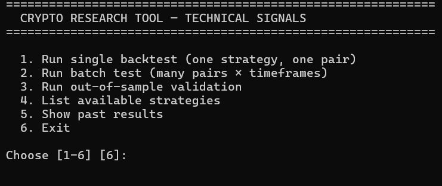
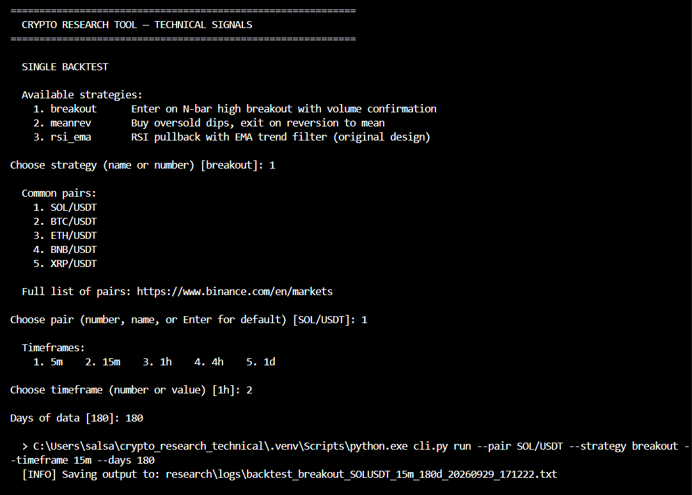
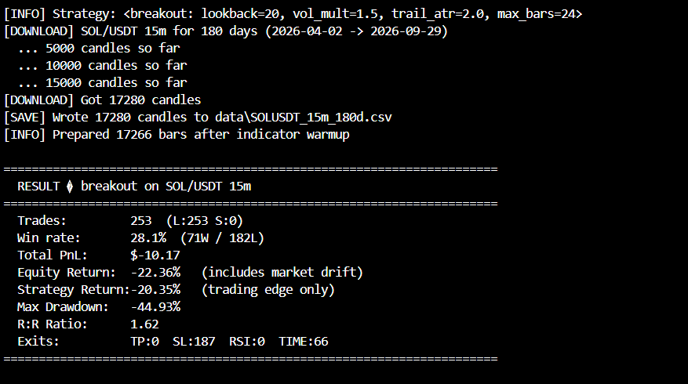
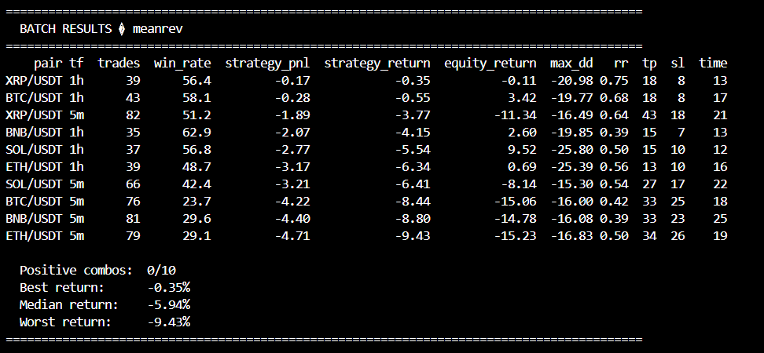
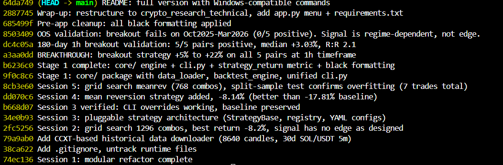

# Crypto Research Tool — Technical Signals











A modular Python framework for researching, backtesting, and validating
cryptocurrency trading strategies. Built to answer one question honestly:
**does this signal have real edge, or is it overfit to historical data?**

## What This Is

A strategy-agnostic research harness for crypto. It handles:

- **Pluggable strategies** — add a new strategy in ~50 lines
- **Multi-pair, multi-timeframe testing** — from 5m to 1d, across 5+ pairs
- **Batch runs** — test one strategy across many pairs/timeframes at once
- **Out-of-sample validation** — test on held-out data, not just the tuned period
- **Honest metrics** — separates strategy edge from market drift
- **Grid search + split-sample** — find parameters without overfitting

It ships with three strategies (`rsi_ema`, `meanrev`, `breakout`) and
documents their performance on 5 liquid crypto pairs across two market regimes.

## What We Found

After rigorously testing three signal families across 5 pairs, 4 timeframes,
and 2 market regimes:

**Simple technical signals do not have robust edge on liquid crypto after fees.**

| Strategy | Best In-Sample | Out-of-Sample | Verdict |
|----------|---------------|---------------|---------|
| RSI/EMA trend | -17.81% (5m) | -7.27% (1h) | No edge |
| Mean reversion | +8.01% (7 trades) | -1.27% (1h) | Overfit |
| Breakout (1h) | +13.55% avg | **-8.4% avg** | Regime-dependent |

**Full analysis:** see [`research/FINDINGS.md`](research/FINDINGS.md).

This negative result is the point — it demonstrates that the framework
correctly distinguishes real edge from in-sample luck. Most retail bots
skip this step and lose money live.

## Features

### Pluggable Strategy Architecture

Every strategy inherits from `StrategyBase` and implements `check_entry` /
`check_exit`. The backtest engine and live runner use the *same* strategy
code, guaranteeing backtest-live parity.

```python
class MyStrategy(StrategyBase):
    name = "my_strategy"
    default_params = {"lookback": 20}

    def check_entry(self, state, row, context):
        if row["close"] > row["ema20"]:
            return Decision("OPEN_LONG")
        return Decision("HOLD")
```

Register it in `registry.py` and it's available everywhere.

### Batch Testing

Run one strategy across many pairs and timeframes in a single command:

```powershell
python batch.py --strategy breakout --pairs SOL/USDT,BTC/USDT,ETH/USDT --timeframes 5m,1h,4h
```

### Out-of-Sample Validation

`oos_test.py` fetches data ending at a *held-out* date and tests the same
strategy. This is the step most retail traders skip.

```powershell
python oos_test.py --strategy breakout --end-date 2026-03-31
```

### Menu-Driven App

For interactive use, `app.py` provides a friendly menu:

```
============================================================
  CRYPTO RESEARCH TOOL — TECHNICAL SIGNALS
============================================================

  1. Run single backtest (one strategy, one pair)
  2. Run batch test (many pairs × timeframes)
  3. Run out-of-sample validation
  4. List available strategies
  5. Show past results
  6. Exit
```

Results stream to the terminal *and* to a timestamped log file in
`research/logs/`, which opens automatically in your default viewer.

## Installation

Requires Python 3.10+.

```powershell
git clone https://github.com/YOUR-USERNAME/crypto-research-technical.git
cd crypto-research-technical
python -m venv .venv
.\.venv\Scripts\Activate.ps1
python -m pip install -r requirements.txt
```

For macOS/Linux, replace the activation step with `source .venv/bin/activate`.

## Quick Start

### Interactive (recommended for first run)

```powershell
python app.py
```

### Command Line

**Single backtest:**

```powershell
python cli.py run --pair SOL/USDT --strategy breakout --timeframe 1h --days 180
```

**Batch across pairs/timeframes:**

```powershell
python batch.py --strategy breakout --pairs SOL/USDT,BTC/USDT,ETH/USDT --timeframes 5m,1h,4h
```

**Out-of-sample validation:**

```powershell
python oos_test.py --strategy breakout --end-date 2026-03-31
```

## Project Structure

```
crypto_research_technical/
├── app.py                  Menu front door
├── cli.py                  Command-line interface
├── batch.py                Multi-pair/timeframe runner
├── oos_test.py             Out-of-sample validation
├── download_data.py        Historical data fetcher (via CCXT)
├── config.py               Global configuration defaults
├── config_loader.py        YAML → config module bridge
├── indicators.py           RSI, ATR, EMA, Bollinger, MACD
├── strategy_base.py        Abstract StrategyBase class
├── registry.py             Strategy discovery & lookup
├── core/
│   ├── data_loader.py      Fetch + cache OHLCV data
│   └── backtest_engine.py  Simulation engine
├── strategies/
│   ├── rsi_ema.py          RSI pullback + EMA trend filter
│   ├── meanrev.py          Buy oversold dips
│   └── breakout.py         N-bar high breakout w/ volume
├── config/                 YAML configs (one per strategy)
├── research/
│   ├── FINDINGS.md         Full analysis writeup
│   ├── analyze_trades.py   Per-trade diagnostic
│   ├── grid_search_v2.py   Parameter search
│   ├── split_test.py       In-sample / OOS split
│   └── batch_results/      Saved CSV results
└── data/                   Cached OHLCV (gitignored)
```

## Adding a New Strategy

Three steps:

1. **Create `strategies/my_strategy.py`** — subclass `StrategyBase`
2. **Create `config/my_strategy.yaml`** — strategy + params
3. **Register in `registry.py`** — one line

Then run:

```powershell
python cli.py run --pair SOL/USDT --strategy my_strategy --timeframe 1h
```

## Configuration

Global defaults live in `config.py` (starting balance, fees, EMA periods).
Per-strategy parameters live in `config/*.yaml`:

```yaml
strategy: breakout
params:
  lookback: 20
  vol_mult: 1.5
  trail_atr: 2.0
  max_bars: 24
```

Override from the CLI without editing files:

```powershell
python cli.py run --pair SOL/USDT --strategy breakout --set lookback=30 --set vol_mult=2.0
```

## Methodology Notes

**Fees are modeled realistically.** Kraken/Binance taker fees (0.26%)
applied on both entry and exit. This is critical — many backtests are
"profitable" until you subtract fees.

**Two return metrics** are reported:

- `equity_return` — includes market drift on the base holding
- `strategy_return` — trading PnL only (the honest edge metric)

**Out-of-sample is mandatory** before considering a strategy live. In-sample
results alone are almost always overfit.

**Trailing stops and time stops** are first-class features, not afterthoughts.

## Key Findings (Summary)

1. **Fees dominate high-frequency strategies.** At 5m, typical moves are
   0.05–0.15% and round-trip fees are 0.52%. The math doesn't work.

2. **In-sample results are often regime-driven, not signal-driven.**
   Breakout went from +13% (in-sample) to -8% (out-of-sample) with identical
   parameters. The market regime changed, not the strategy.

3. **Trailing stops are more effective than fixed TP on trending pairs.**
   The breakout strategy shows R:R ratios above 2.0 on 1h, driven by
   letting winners run.

4. **Long-only strategies lose in bear markets.** Regime filters are
   essential, not optional.

See [`research/FINDINGS.md`](research/FINDINGS.md) for the full story.

## Requirements

- Python 3.10+
- `pandas`, `numpy`, `requests`, `ccxt`, `pyyaml`, `black`

See `requirements.txt`.

## License

MIT

## Author

Built as a research project exploring whether retail-accessible technical
signals can produce edge on liquid crypto markets. Spoiler: mostly no — but
the framework is reusable for testing any future idea.